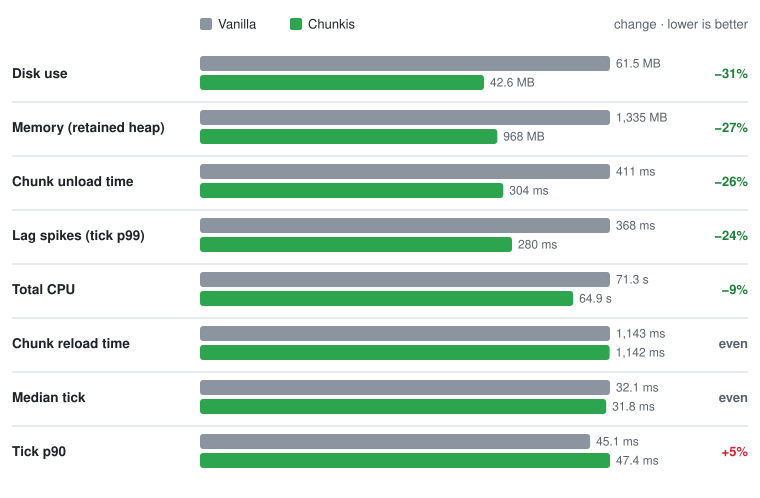
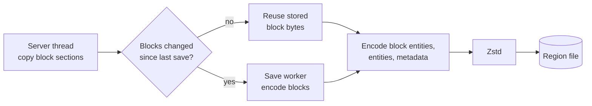
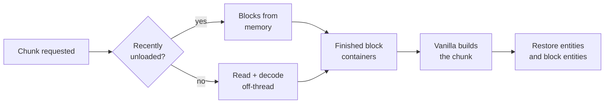

<div align="center">


**Smaller worlds. Lighter servers. Zero silent data loss.**

A Fabric mod that replaces vanilla chunk storage<br>
with a compact, versioned format built for safety.

[](https://github.com/Liparakis/Chunkis/actions/workflows/ci.yml)


[](LICENSE)

**[Install](#install)** · **[Performance](#performance)** · **[How it works](#how-it-works)** · **[Wiki](https://github.com/Liparakis/Chunkis/wiki)** · **[Contribute](CONTRIBUTING.md)**

<br>

## Performance



<sub>Stress benchmark: a 64×64-chunk area of natural terrain unloaded, reloaded, edited and saved,<br>
alternating Chunkis and vanilla runs on the same machine (<a href="tools/stress/README.md">details</a>).<br>
Results vary with world, workload and hardware.</sub>

<br>

## Install

**1.** Install [Fabric Loader](https://fabricmc.net/use/) and [Fabric API](https://modrinth.com/mod/fabric-api) for Minecraft **1.21.11**<br>
**2.** Drop the Chunkis jar into `mods/` (Java 21+)<br>
**3.** **Back up your world**, then launch

⚠️ **Switching to Chunkis is one-way.** There's no converter back to vanilla storage,<br>
so keep a backup you can restore without Chunkis.

Existing worlds migrate automatically when opened in singleplayer.<br>
Dedicated-server migration isn't available yet.

<br>

## How it works

Vanilla saves every chunk as a full NBT tree, compressed into 4 KiB sectors of `.mca` region files,<br>
and parses that tree again on every load. Chunkis keeps its own compact record of each chunk<br>
and moves the expensive work off the server thread.

### 1 · Tracking a chunk

Every loaded chunk carries a `ChunkDelta`: its blocks, block entities, entities and metadata.<br>
Block changes are recorded as they happen. A chunk only counts as Chunkis's once it's explicitly **claimed**,<br>
and only then does Chunkis take over its saves; anything unclaimed is saved by vanilla as usual.

### 2 · Saving



The server thread does only one cheap thing: it copies the chunk's block sections.<br>
Everything else happens on background **save workers**. A content fingerprint tells whether the blocks<br>
changed since the last save. If they didn't, the stored block bytes are reused instead of encoded again.

The entry is compressed with Zstd and written to the chunk's region file **byte-exact**: a 1 KiB entry<br>
takes 1 KiB, not a 4 KiB sector. A save never overwrites the live copy. The new entry goes to free space,<br>
and the old one is released only after the new header is safely on disk.

### 3 · The CIS format

Each entry holds a palette of block states, the chunk's sections, block entities, entities and metadata:<br>
structures, heightmaps, biomes, light and pending ticks.

Sections are stored **sparse** (just the changed positions) or **dense** (every block).<br>
Dense sections are **context-coded**: each block is predicted from its neighbors, and only the misses cost bits,<br>
which suits terrain where stone sits next to stone. Each coded section has its own stream, so they decode in parallel.

The format is versioned. Older versions are upgraded automatically by the migration module,<br>
and earlier layouts of the current version still decode.

### 4 · Loading



Loads first check memory: chunks unloaded a moment ago keep their blocks in a bounded cache,<br>
so walking back skips decoding entirely. Otherwise the entry is read, under its own region's lock<br>
so other loads aren't held up, and decoded off the server thread.

Instead of NBT for vanilla to parse, Chunkis hands vanilla **finished block containers**,<br>
together with the stored heightmaps, biomes, light and pending ticks, so vanilla rebuilds none of them.<br>
The server thread then restores block entities and entities, once per load,<br>
and vanilla sends the chunk to players as usual.

### 5 · Chunks still generating

Chunks around the loaded area are often only partly generated. Vanilla saves them in that state;<br>
dropping them would mean generating them again on every visit. Chunkis keeps them too,<br>
in the same compact region format under `unfinished/`.

### 6 · Safety

A chunk Chunkis hasn't claimed is never kept from being saved by vanilla.<br>
An entry that fails to decode, for example because a mod is missing, is never overwritten.<br>
Saves to that chunk are refused until the cause is fixed.

When an existing world is migrated, each vanilla region is backed up and verified before it's retired.<br>
A chunk that fails to migrate stops the startup instead of leaving a half-migrated world.

<sub>The <a href="https://github.com/Liparakis/Chunkis/wiki">wiki</a> covers each step in depth.</sub>

<br>

<details>
<summary><b>📁 Where the data lives</b></summary>
<br>

```text
<world>/chunkis/
├── global_ids.json     block-id mapping
├── portal_chunks.nbt   portal index
├── portal_links.nbt
├── regions/            r.<x>.<z>.cis
└── unfinished/         chunks still generating
```

Other dimensions use `<world>/dimensions/<namespace>/<path>/chunkis/`.<br>
Format: CIS v12; older data upgrades automatically.

</details>

<details>
<summary><b>⚙️ Configuration</b></summary>
<br>

No configuration needed. Optional JVM flags:

<table>
<tr><th>Flag</th><th>Default</th><th>Effect</th></tr>
<tr><td><code>-Dchunkis.recentChunkCacheMb</code></td><td><code>256</code></td><td>Reload cache size; <code>0</code> disables it</td></tr>
<tr><td><code>-Dchunkis.portal.fallbackRadius</code></td><td><code>20</code></td><td>Safe portal arrival search radius</td></tr>
</table>

</details>

<details>
<summary><b>🔨 Building from source</b></summary>
<br>

```bash
./gradlew build    # Windows: gradlew.bat build
```

Runs unit tests, checkstyle and Fabric game tests.<br>
The jar lands in `fabric/build/libs/`.

</details>

<br>

## Compatibility

Test carefully with mods or tools that expect vanilla `.mca` files:<br>
ones that read or write Anvil region files directly, serialize or migrate chunks themselves,<br>
or edit chunks after world generation.

**Always try Chunkis on a copy of your world first.**

<br>

## Contributing

Pull requests are welcome, including AI-assisted ones,<br>
as long as a human reviews the code and the author can explain every change.

**[Read CONTRIBUTING.md](CONTRIBUTING.md)** · **[Open an issue](https://github.com/Liparakis/Chunkis/issues)**

<br>

## Built with AI

Chunkis is developed with the help of AI coding assistants,<br>
used for writing code, tests, benchmarks and docs.<br>
Every change is reviewed, tested and owned by the maintainer.

<br>

<sub>Released under the <a href="LICENSE">MIT License</a></sub>

</div>
