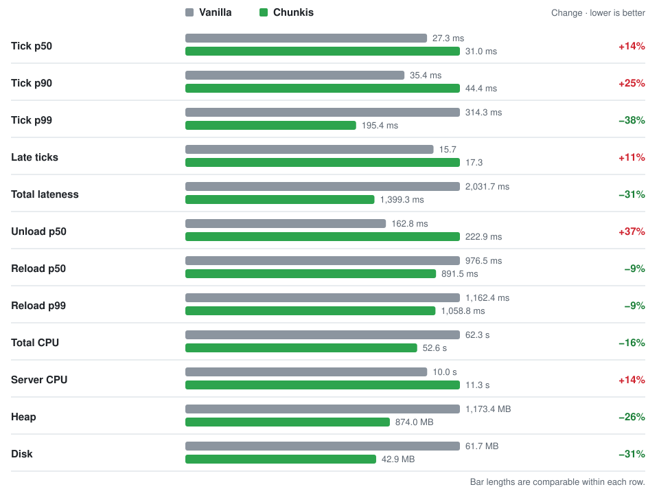

<!--suppress HtmlDeprecatedAttribute -->

<h1>
<!--suppress CheckImageSize -->

</h1>

### Compact chunk storage for Minecraft.

A Fabric mod that saves worlds in **CIS**, a versioned alternative to vanilla region storage.

   

**[Download](https://github.com/Liparakis/Chunkis/releases)** &nbsp; · &nbsp; **[Install](#install)** &nbsp; · &nbsp; **[Wiki](https://github.com/Liparakis/Chunkis/wiki)** &nbsp; · &nbsp; **[Report an issue](https://github.com/Liparakis/Chunkis/issues)**

> **Minecraft 26.2, Java 25 · [Chunkis 4.2.1](https://github.com/Liparakis/Chunkis/releases/tag/v4.2.1-mc26.2).** For Minecraft 26.1.2, use [v4.2.1](https://github.com/Liparakis/Chunkis/releases/tag/v4.2.1); for 1.21.11, use [v4.1.2](https://github.com/Liparakis/Chunkis/releases/tag/v4.1.2).
> Port changes and validation: [26.2 port notes](docs/port-26.2.md).

## Performance

Ryzen 7 5700X at 4.6 GHz · 32 GB DDR4-3600 · Unpinned · 6 November 2026

These published measurements are from Minecraft 1.21.11.

Three alternating runs per side, each unloading, reloading, editing, and saving **4,096 natural-terrain chunks** over two measured rounds. Related measurements sit together in the chart; percentiles are averaged across runs. Results vary with the world, hardware, and background activity.

[Every metric and scenario setting in text](docs/benchmark-2026-11-06.md) · [Methodology and reproduction](tools/stress/README.md)

## Install

> [!WARNING]
> **Back up your world before the first launch.** There is no converter from CIS back to vanilla. Dedicated-server migration is not available yet.

1. Set up [Fabric Loader](https://fabricmc.net/use/) **0.20.1+** and [Fabric API](https://modrinth.com/mod/fabric-api) for the Minecraft version above.
2. Put the Chunkis release jar in `mods/`.
3. Launch with Fabric. Existing singleplayer worlds migrate automatically when opened.

Mods and tools that access `.mca` files directly, migrate chunks, or edit them after generation need testing on a copy of your world.

## Inside Chunkis

**Save less work.** The server thread copies block sections; workers encode and write them. Unchanged encoded blocks are reused. Compressed region entries occupy their actual size instead of whole 4 KiB sectors.

**Reuse recent loads.** A bounded cache retains recently unloaded blocks. Other loads read and decode region data off-thread, supplying block containers and metadata for vanilla to rebuild the chunk.

**Keep failures explicit.** New entries are written to free space before old entries are released. A chunk that fails to decode cannot be overwritten by normal saves. Migration verifies and backs up vanilla regions before retirement; a failed chunk stops startup.

Format and storage layout

Chunkis takes over saves only for chunks it has claimed; unclaimed chunks remain with vanilla. CIS stores blocks, block entities, entities, structures, biomes, light, heightmaps, and pending ticks. Partly generated chunks are kept under `unfinished/`. Entity saves without a safe terrain record are kept independently under `entity-fallback/`.

The current format is **CIS v12**. Older versions are upgraded by the migration module. Data lives in `<world>/chunkis/`; other dimensions use `<world>/dimensions/<namespace>/<path>/chunkis/`.

Optional configuration

No configuration is required. Optional JVM flags:

| Flag | Default | Effect |
|:---|:---|:---|
| `-Dchunkis.recentChunkCacheMb` | `256` | Recent-chunk cache size in MB; `0` disables it. |
| `-Dchunkis.portal.fallbackRadius` | `20` | Safe portal arrival search radius. |

## Development

See [CONTRIBUTING.md](CONTRIBUTING.md) for setup, testing, benchmarks, and review requirements. [AGENTS.md](AGENTS.md) covers agent-written changes.

Chunkis is developed with AI assistance. A human reviews, tests, and takes responsibility for every change.
